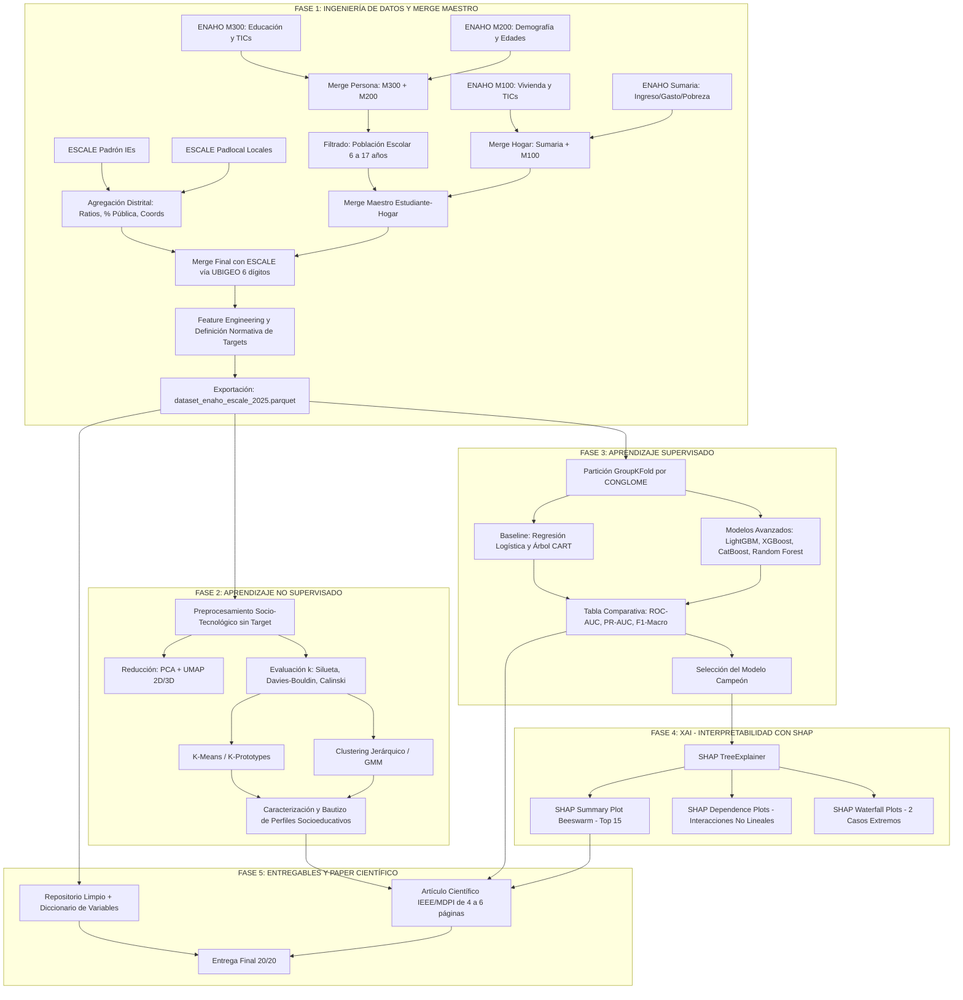

# GUÍA TÉCNICA Y PLAN MAESTRO DE EJECUCIÓN (CODEX / AGENTE IA)
## PROYECTO IA: BRECHA DIGITAL Y RENDIMIENTO ESCOLAR EN EL PERÚ (CORTE TRANSVERSAL 2025)
**Curso:** Inteligencia Artificial — Escuela de Ingeniería de Sistemas  
**Fuentes de Datos:** ENAHO Panel 2021–2025 (INEI, Encuesta 1041 - Corte Anual 2025) + ESCALE Censo Educativo 2025 (MINEDU)  
**Calificación Objetivo:** 20 / 20 puntos  
**Semilla Global de Reproducibilidad:** `random_state = 42`

---

## 1. VISIÓN GENERAL Y ALCANCE METODOLÓGICO

El proyecto consiste en diseñar, implementar, validar y documentar un pipeline completo de Machine Learning (No Supervisado + Supervisado + Explicabilidad XAI con SHAP) que integre los microdatos de hogares del Perú con la infraestructura escolar distrital.

### Definición del Alcance Temporal de los Datos
- **Fuente INEI:** Se dispone de la base de datos de la Encuesta Nacional de Hogares (ENAHO) Panel 2021–2025 (Encuesta N° 1041).
- **Alcance del Proyecto:** Se trabajará con el **corte transversal anual correspondiente al año 2025** (filtrando las observaciones activas en 2025 mediante `conglome_25.notna()`). No se construye un modelo dinámico de panel longitudinal plurianual, cumpliendo estrictamente con la especificación técnica del docente (*"CORTE DE DATOS: ENAHO + ESCALE 2025"*).

### Rúbrica de Evaluación (20 Puntos)
| Fase | Criterio de Evaluación | Requisitos Técnicos Clave | Puntaje |
| :---: | :--- | :--- | :---: |
| **Fase 1** | **Ingeniería de Datos y Zero Data Leakage** | Cruce relacional por llaves compuestas preservando ceros a la izquierda (`dtype=str`). Filtrado de población escolar (6-17 años). Enriquecimiento con agregaciones distritales de ESCALE (Padrón de IEs y Locales). Partición obligatoria agrupada por conglomerado (`GroupShuffleSplit` / `GroupKFold` sobre `CONGLOME`). Preprocesadores ajustados (`fit`) estrictamente solo en `train`. Cero variables proxy directas. | **5 pts** |
| **Fase 2** | **Modelado No Supervisado (Clustering)** | Preprocesamiento y escalamiento robusto (`RobustScaler`). Proyecciones PCA y UMAP (2D/3D). Comparación de al menos 2 algoritmos (K-Means vs Clustering Jerárquico o GMM). Selección de $k$ justificada con Silueta, Davies-Bouldin y Calinski-Harabasz. Bautizo y caracterización socioeducativa de clusters (evitando circularidad con el target). | **4 pts** |
| **Fase 3** | **Modelado Supervisado (Clasificación)** | Formulación del problema predictivo de **Rezago Escolar** (y opcional Exclusión Digital). Comparación de Baseline (Regresión Logística / Árbol CART) frente a al menos 3 algoritmos avanzados (LightGBM, XGBoost, CatBoost, Random Forest). Manejo de desbalance (`class_weight`) y ponderación muestral (`FACTOR07`). Métricas completas: ROC-AUC, PR-AUC, F1-Macro, Matriz de Confusión y Curva de Calibración. | **5 pts** |
| **Fase 4** | **Inteligencia Artificial Explicable (XAI)** | Extracción de explicaciones con SHAP (TreeExplainer). Gráfico SHAP Summary (Beeswarm) del top 10-15 variables. Al menos 2 gráficos SHAP Dependence para interacciones no lineales (ej. Quechua/Aymara vs Internet; Ratio alumno/docente vs Rezago). Explicación individual extrema con 2 gráficos SHAP Waterfall (caso de alto riesgo vs bajo riesgo). | **3 pts** |
| **Fase 5** | **Entregables, Código Limpio y Paper IEEE/MDPI** | Estructura limpia de repositorio (`data/`, `src/`, `notebooks/`, `reports/`). Dataset procesado final en formato Parquet + CSV + Diccionario de Variables. Informe técnico en formato de artículo científico de 4 a 6 páginas (estilo IEEE/MDPI) con rigor analítico y recomendaciones de política pública. | **3 pts** |

---

## 2. MAPA DE ARCHIVOS DISPONIBLES EN EL WORKSPACE

El espacio de trabajo se encuentra limpio y estructurado en `proyecto_ia/`:

```text
proyecto_ia/
├── data/
│   ├── raw/                           <-- Microdatos crudos listos (Filtrados a 2025)
│   │   ├── enaho_m100_2025.csv        (44,599 registros - Vivienda, luz eléctrica, TIC hogar)
│   │   ├── enaho_m200_2025.csv        (115,145 registros - Demografía, edad, sexo, parentesco)
│   │   ├── enaho_m300_2025.csv        (106,958 registros - Educación, lengua materna, asistencia, grado y TICs)
│   │   ├── enaho_sumaria_2025.csv     (33,702 registros - Ingreso/gasto per cápita, pobreza, factor)
│   │   ├── escale_padron.csv          (112,724 registros - IEs de Perú, alumnos, docentes, coords)
│   │   └── escale_padlocal.csv        (69,642 registros - Locales escolares, tipo de local y estado)
│   ├── processed/                     <-- Destino de los datasets finales procesados
│   │   ├── dataset_enaho_escale_2025.parquet
│   │   ├── dataset_enaho_escale_2025.csv
│   │   └── diccionario_variables.csv
│   └── docs/                          <-- Diccionarios y cuestionarios oficiales de referencia
│       ├── Guia_de_Evaluacion.pdf
│       ├── Ficha_Tecnica_ENAHO_1041.pdf
│       ├── Diccionario_ENAHO_panel.pdf
│       ├── CUESTIONARIO_M100_2025.pdf
│       ├── CUESTIONARIO_M300_educacion_TIC_2025.pdf
│       ├── Sumaria_metodologia.pdf
│       ├── Diccionario_ESCALE_CE_2025.pdf
│       └── Diccionario_ESCALE_LE_2025.pdf
├── notebooks/                         <-- Notebooks interactivos y reproducibles
│   ├── 01_ingenieria_datos.ipynb
│   ├── 02_clustering_perfilamiento.ipynb
│   ├── 03_modelos_supervisados.ipynb
│   └── 04_explicabilidad_shap.ipynb
├── src/                               <-- Módulos de Python reutilizables
│   ├── __init__.py
│   ├── config.py                      (Rutas, constantes, llaves estandarizadas y parámetros)
│   ├── data_loader.py                 (Carga segura de datos y tipado estricto)
│   ├── feature_engineering.py         (Agregación ESCALE, merges y cálculo de targets)
│   ├── evaluation.py                  (Métricas, curvas ROC/PR, matrices y calibración)
│   └── visualization.py               (Estilos de gráficos, PCA/UMAP, SHAP helpers)
├── reports/                           <-- Informe final en formato artículo científico
│   ├── figures/                       (Gráficos de alta resolución exportados en PNG/PDF)
│   └── paper_brecha_digital_ieee.md   (Artículo científico completo listo para exportar a PDF)
├── requirements.txt                   <-- Dependencias de Python fijadas
└── PLAN_DE_TRABAJO.md                 <-- Esta guía técnica de ejecución
```

---

## 3. ADVERTENCIAS CRÍTICAS DE INGENIERÍA Y REGLAS TÉCNICAS

### 1. Variables Educativas Específicas del Módulo 300
Para evitar errores de formulación en el rezago escolar, se debe usar la siguiente taxonomía oficial del cuestionario:
- `p300a_25`: **Lengua o idioma materno** aprendida en la niñez.
- `p306_25`: **Matrícula escolar actual** (1=Sí, 2=No).
- `p307_25`: **Asistencia escolar actual** (1=Sí, 2=No).
- `p308a_25`: **Nivel educativo actual que cursa en 2025** (1=Inicial, 2=Primaria, 3=Secundaria, 4=Básica Especial, etc.).
- `p308b_25`: **Grado o año de estudio actual que cursa en 2025** (1 a 6 en Primaria, 1 a 5 en Secundaria).
- `p301a_25`: Representa el *último año/grado aprobado en el pasado* (no usar para la matrícula activa del año en curso).

### 2. Temporalidad Exacta de Variables TIC
- `p314a_25`: Formula explícitamente: *"¿En el **mes anterior** hizo uso del servicio de internet?"* (1=Sí, 2=No). Debe describirse y documentarse con exactitud como **uso en el mes anterior**.
- `p314b_1_25` a `p314b_7_25`: Lugares de acceso a internet en el mes anterior (1=Hogar, 2=Cabina pública, 3=Centro educativo, etc.).

### 3. Preservación Estricta de Ceros a la Izquierda en Llaves
- Todas las columnas de identificación geográfica y del hogar deben cargarse como texto (`dtype=str`) y normalizarse a longitud estándar con `.str.zfill()`:
  - `conglome_25` (6 caracteres)
  - `vivienda_25` (3 caracteres)
  - `hogar_25` (2 caracteres)
  - `codperso_25` (2 caracteres)
  - `ubigeo_25` y `codgeo` (6 caracteres obligatorios)
  - `codlocal` y `cod_mod` (texto)

### 4. Integración Clara de Ambas Fuentes ESCALE (Padrón y Padlocal)
- **`escale_padron.csv` (Fuente principal de IEs):** Aporta `TALUM` (alumnos), `TDOC` (docentes), `TSEC` (secciones), `GESTION` (pública/privada), `DAREACENSO` (urbano/rural) y coordenadas distritales `NLAT_IE`, `NLONG_IE`.
- **`escale_padlocal.csv` (Fuente de locales escolares):** Se agrupa por `CODGEO` para aportar métricas de densidad física distrital:
  - `escale_total_locales`: Cantidad de locales físicos en el distrito.
  - `escale_pct_locales_rurales`: Porcentaje de infraestructura física escolar en zona rural (`AREA_LOC == '2'`).

### 5. Prevención de Circularidad en Clustering (No Data Leakage hacia la Fase 2)
- **Regla Metodológica:** Las variables de rezago escolar **NO deben ser variables de entrada (features) para el clustering**.
- El clustering debe modelar puramente el **perfil socioeconómico, tecnológico y del entorno escolar** (gasto per cápita, internet en el hogar, disponibilidad de luz eléctrica, equipamiento TIC, sobrecarga docente distrital y ruralidad).
- **Uso de Rezago en Clustering:** Una vez formados los clusters, la tasa de rezago escolar se calcula como **métrica de caracterización descriptiva externa** (ej. *"El Cluster Rural registra un 28.4% de rezago escolar frente al 6.2% del Cluster Urbano Consolidado"*). Esto otorga total rigor científico al estudio.

### 6. Protocolo Cero Data Leakage en Modelado Supervisado
- **Partición:** Prohibido usar `train_test_split` aleatorio simple. Usar obligatoriamente `GroupKFold(n_splits=5)` o `GroupShuffleSplit` agrupando por `conglome_25`.
- **Ajuste de Pipelines:** Cualquier transformación (`RobustScaler`, `SimpleImputer`, `OneHotEncoder`) debe ajustarse (`fit`) **solo en el conjunto de entrenamiento** y aplicarse (`transform`) en prueba.
- **Variables Proxy:** Excluir variables que revelen directamente el resultado final del año o el cálculo monetario exacto de la línea de pobreza (`linea_25`).

---

## 4. ESPECIFICACIÓN DETALLADA DE LAS 5 FASES DE TRABAJO



---

### FASE 1: INGENIERÍA DE DATOS Y MERGE MAESTRO (5 PUNTOS)

#### 1.1 Ingesta y Tipado Seguro
- Cargar `enaho_m300_2025.csv`, `enaho_m200_2025.csv`, `enaho_m100_2025.csv` y `enaho_sumaria_2025.csv`.
- Tipado `dtype=str` con relleno de ceros (`zfill`):
  - `conglome_25` (6), `vivienda_25` (3), `hogar_25` (2), `codperso_25` (2), `ubigeo_25` (6).

#### 1.2 Agregación Contextual de ESCALE a Nivel Distrital
- **Padrón de Instituciones Educativas (`escale_padron.csv`):**
  - Limpiar y convertir a numérico: `TALUM`, `TDOC`, `TSEC`, `NLAT_IE`, `NLONG_IE`.
  - Normalizar `CODGEO` a 6 dígitos (`str.zfill(6)`).
  - Agrupar por `CODGEO` para calcular:
    - `escale_total_alumnos`: Suma distrital de `TALUM`.
    - `escale_total_docentes`: Suma distrital de `TDOC`.
    - `escale_ratio_alumno_docente`: `escale_total_alumnos / (escale_total_docentes + 1e-5)`.
    - `escale_pct_colegios_publicos`: Proporción de IEs con `GESTION == '1'`.
    - `escale_lat_centroide`: Media distrital de `NLAT_IE`.
    - `escale_lon_centroide`: Media distrital de `NLONG_IE`.
- **Locales Escolares (`escale_padlocal.csv`):**
  - Agrupar por `CODGEO` a 6 dígitos para calcular:
    - `escale_total_locales`: Cantidad física de locales escolares.
    - `escale_pct_locales_rurales`: Proporción de locales con `AREA_LOC == '2'`.

#### 1.3 Merge Relacional en Cascada
1. **Unión Nivel Persona:** `M300` + `M200` mediante `['conglome_25', 'vivienda_25', 'hogar_25', 'codperso_25']`.
2. **Filtrado Población Objetivo:**
   $$\text{Población Objetivo} = \{i \mid 6 \le \text{p208a\_25}_i \le 17\}$$
3. **Unión Nivel Hogar:** `Sumaria` + `M100` mediante `['conglome_25', 'vivienda_25', 'hogar_25']`.
4. **Merge Persona-Hogar:** Unir la tabla de escolares con sus respectivos hogares.
5. **Merge Distrital:** Unir con las métricas distritales consolidadas de ESCALE mediante:
   $$\text{ubigeo\_25 (6 dígitos)} == \text{CODGEO (6 dígitos)}$$

#### 1.4 Definición Metodológica de Rezago Escolar
Se sustenta formalmente en la normativa del Ministerio de Educación del Perú (**Resolución Ministerial N° 064-2022-MINEDU** sobre edades normativas de ingreso y permanencia en la Educación Básica Regular):

1. **Subpoblación evaluable:** Estudiantes que asisten a la escuela (`p307_25 == 1` o `p306_25 == 1`) y que se encuentran cursando Primaria (`p308a_25 == 2`) o Secundaria (`p308a_25 == 3`) con grado válido reportado (`p308b_25`).
2. **Cálculo de la Edad Teórica Normativa ($E_N$):**
   - **Educación Primaria ($g \in [1, 6]$):**
     $$E_N = g + 5 \quad (\text{1.° Primaria = 6 años, ..., 6.° Primaria = 11 años})$$
   - **Educación Secundaria ($g \in [1, 5]$):**
     $$E_N = g + 11 \quad (\text{1.° Secundaria = 12 años, ..., 5.° Secundaria = 16 años})$$
3. **Regla de Tolerancia y Rezago:** Considerando la fecha de corte reglamentaria de matrícula al 31 de marzo, se establece una tolerancia formal de 1 año:
   $$\text{rezago\_escolar} = \begin{cases} 1 & \text{si } \text{edad} > (E_N + 1) \\ 0 & \text{si } \text{edad} \le (E_N + 1) \end{cases}$$
   *(Los casos de Inicial, Básica Especial o no escolarizados se etiquetan o excluyen de forma controlada según el objetivo del análisis)*.

#### 1.5 Definición de Exclusión Digital Efectiva
$$\text{exclusion\_digital} = \begin{cases} 1 & \text{si } (\text{p1144\_25} \neq 1) \land (\text{p314a\_25} \neq 1) \land (\text{p1141\_25} \neq 1 \land \text{p1142\_25} \neq 1) \\ 0 & \text{en caso contrario} \end{cases}$$

#### 1.6 Exportación de Artefactos de la Fase 1
- `proyecto_ia/data/processed/dataset_enaho_escale_2025.parquet`
- `proyecto_ia/data/processed/dataset_enaho_escale_2025.csv`
- `proyecto_ia/data/processed/diccionario_variables.csv`

---

### FASE 2: MODELADO NO SUPERVISADO (CLUSTERING Y PERFILAMIENTO) (4 PUNTOS)

#### 2.1 Variables Seleccionadas (Socio-Tecnológicas y de Entorno Escolar)
- `log_gasto_pc`: $\log(\text{gashog2d\_25} + 1)$ (gasto per cápita del hogar).
- `log_ingreso_pc`: $\log(\text{inghog2d\_25} + 1)$ (ingreso per cápita del hogar).
- `internet_hogar`: Conexión de internet en la vivienda (`p1144_25`).
- `luz_electrica`: Acceso a electricidad (`p1121_25`).
- `equipamiento_tic`: Índice de equipamiento (computadora `p1141_25` + laptop `p1142_25` + tablet `p1143_25`).
- `uso_internet_mes`: Uso individual de internet en el mes anterior (`p314a_25`).
- `estrato_rural`: Estrato geográfico (`estrato_25`).
- `escale_ratio_alumno_docente`: Ratio distrital alumnos/docente.
- `escale_pct_colegios_publicos`: Proporción de colegios públicos en el distrito.
*(Nota: No se incluye `rezago_escolar` para evitar circularidad)*.

#### 2.2 Preprocesamiento y Reducción de Dimensionalidad
- Imputación de valores faltantes (mediana en numéricas).
- Escalamiento: `RobustScaler` (resistente a colas pesadas de ingresos y ratios).
- **PCA:** Reducción a 2 y 3 componentes principales analizando el codo de varianza explicada.
- **UMAP:** Proyección a 2D para visualización no lineal de agrupaciones naturales y separabilidad.

#### 2.3 Comparación de Algoritmos y Justificación Matemática de $k$
- Evaluar $k \in [2, 8]$ comparando:
  1. **K-Means** (con inicialización K-Means++).
  2. **Clustering Jerárquico Aglomerativo** (Ward linkage) o **GMM** (Gaussian Mixture Models).
- Métricas obligatorias a calcular y graficar para cada $k$:
  - **Silhouette Score:** Cohesión y separación media.
  - **Davies-Bouldin Index:** Minimización de similitud inter-cluster.
  - **Calinski-Harabasz Index:** Ratio de dispersión inter/intra cluster.

#### 2.4 Caracterización y Bautizo de Perfiles Socioeducativos
Elaborar tabla descriptiva con medias de cada feature por cluster y **calcular la tasa resultante de rezago escolar como variable de contraste externa**. Asignar nombres pedagógicos formales:
- *Cluster 1:* **"Rural Altoandino con Aislamiento Digital Severo y Dependencia Pública"** (Alta tasa de rezago observada).
- *Cluster 2:* **"Urbano Vulnerable con Acceso TIC Móvil pero Carencia de Equipamiento en Hogar"** (Rezago moderado).
- *Cluster 3:* **"Urbano Consolidado con Plena Conectividad y Alto Gasto en Educación"** (Baja tasa de rezago).

---

### FASE 3: MODELADO SUPERVISADO (CLASIFICACIÓN) (5 PUNTOS)

#### 3.1 Partición Estricta Anti-Fuga de Datos
- Variable de agrupación obligatoria: `conglome_25`.
- Esquema de validación: `GroupKFold(n_splits=5)`.
- Garantiza independencia espacial y previene memorización de patrones vecinales o familiares.

#### 3.2 Manejo del Desbalance de Clases
- Ajustar pesos de clase con `class_weight='balanced'` en scikit-learn / LightGBM y `scale_pos_weight` en XGBoost.
- Considerar el factor de expansión muestral (`sample_weight = factor07_25`) para proyectar la inferencia a nivel poblacional nacional.

#### 3.3 Modelos a Entrenar y Comparar
1. **Baseline 1:** Regresión Logística (`LogisticRegression`, penalización L2).
2. **Baseline 2:** Árbol de Decisión CART (`DecisionTreeClassifier`, `max_depth=5`).
3. **Avanzado 1:** Random Forest (`RandomForestClassifier`, 200 árboles).
4. **Avanzado 2:** LightGBM (`LGBMClassifier`).
5. **Avanzado 3:** XGBoost (`XGBClassifier`).
6. **Avanzado 4:** CatBoost (`CatBoostClassifier`).

#### 3.4 Métricas de Evaluación Obligatorias
Para cada modelo en validación cruzada y en el fold de prueba independiente:
- **ROC-AUC:** Capacidad de discriminación global.
- **PR-AUC (Precision-Recall AUC):** Métrica primordial ante desbalance de clases.
- **F1-Score Macro y F1-Score Clase Positiva:** Balance de precisión y recall.
- **Matriz de Confusión:** Cuantificación rigurosa de Falsos Positivos vs Falsos Negativos.
- **Curva de Calibración:** Fiabilidad probabilística de las predicciones.

---

### FASE 4: INTELIGENCIA ARTIFICIAL EXPLICABLE (XAI CON SHAP) (3 PUNTOS)

#### 4.1 SHAP TreeExplainer
- Instanciar `shap.TreeExplainer` sobre el mejor modelo supervisado (LightGBM / CatBoost).
- Calcular los valores SHAP sobre el conjunto de test: `shap_values = explainer(X_test)`.

#### 4.2 SHAP Summary Plot (Beeswarm)
- Gráfico Beeswarm con el **top 10 a 15 de variables más determinantes**.
- Análisis cuantitativo del sentido del impacto (positivo/negativo) sobre el riesgo de rezago escolar.

#### 4.3 SHAP Dependence Plots (Interacciones No Lineales)
Generar e interpretar al menos 2 gráficos de dependencia con selección de interacción:
1. **Interacción 1 (Etnicidad y Conectividad):** `lengua_originaria` (Quechua/Aimara) vs `internet_hogar` (`p1144_25`). Demostrar el impacto multiplicador de la brecha digital en poblaciones originarias.
2. **Interacción 2 (Economía y Entorno Escolar):** `log_gasto_pc` vs `escale_ratio_alumno_docente`. Demostrar el efecto de la precariedad económica ante aulas sobrecargadas.

#### 4.4 SHAP Waterfall Plots (Casos Individuales Extremos)
- **Caso 1 (Alto Riesgo Predicho Correctamente):** Estudiante con rezago real predicho con alta probabilidad. Desglose aditivo de los factores familiares, digitales y escolares que elevaron el riesgo.
- **Caso 2 (Bajo Riesgo Predicho Correctamente):** Estudiante sin rezago predicho con muy baja probabilidad. Desglose de los factores de protección.

---

### FASE 5: ENTREGABLES Y REDACCIÓN CIENTÍFICA (3 PUNTOS)

#### 5.1 Cuatro Notebooks Limpios y Reproducibles en `notebooks/`
- `01_ingenieria_datos.ipynb`: Ingesta, cruce relacional, agregado ESCALE, cálculo normativo de targets y prevención de data leakage.
- `02_clustering_perfilamiento.ipynb`: Preprocesamiento, PCA/UMAP, métricas de $k$, bautizo y caracterización externa con rezago.
- `03_modelos_supervisados.ipynb`: GroupKFold por conglomerado, baselines vs avanzados, curvas ROC/PR, calibración y tabla comparativa.
- `04_explicabilidad_shap.ipynb`: SHAP Summary Beeswarm, Dependence plots e interpretaciones Waterfall.

#### 5.2 Artículo Científico en `reports/paper_brecha_digital_ieee.md` (4 a 6 páginas)
Estructura según el estándar IEEE / MDPI:
1. **Title & Abstract:** Resumen técnico formal con resultados numéricos.
2. **I. Introduction:** Contexto socioeducativo, brecha digital y justificación del problema en el Perú.
3. **II. Data Engineering & Zero Data Leakage Methodology:**
   - Diagrama metodológico de fusión relacional.
   - Demostración formal del protocolo anti-fuga de datos por `CONGLOME`.
   - Formulación matemática del rezago escolar según RM N° 064-2022-MINEDU.
4. **III. Unsupervised Learning Results (Clustering):**
   - Justificación matemática del $k$ óptimo (Silueta, Davies-Bouldin, Calinski).
   - Proyecciones visuales PCA/UMAP.
   - Tabla de perfiles socioeducativos bautizados y su contraste con la tasa de rezago.
5. **IV. Supervised Learning Results:**
   - Tabla comparativa de modelos (Baseline vs Random Forest vs LightGBM vs XGBoost vs CatBoost).
   - Curvas ROC y Precision-Recall.
   - Análisis crítico de errores (FP vs FN).
6. **V. Algorithmic Explainability with SHAP (XAI):**
   - Análisis global de determinantes (Beeswarm).
   - Análisis de interacciones no lineales (Dependence).
   - Auditoría clínica de decisiones individuales (Waterfall).
7. **VI. Educational Policy Recommendations:** Propuestas de política pública basadas en la evidencia matemática.
8. **References:** Citas formales en formato IEEE.

---

## 5. GUÍA DE EJECUCIÓN DIRECTA PARA CODEX / AGENTE IA

```bash
# 1. Verificar dependencias
python -m pip install -r proyecto_ia/requirements.txt

# 2. Testear configuración
python -c "
import sys; sys.path.append('proyecto_ia')
from src import config
print('Semilla:', config.RANDOM_STATE)
print('Target:', config.TARGET_REZAGO)
print('Variables clave:', config.COL_LENGUA, config.COL_NIVEL_ACTUAL, config.COL_GRADO_ACTUAL)
"

# 3. Ejecutar construcción de dataset maestro
# 4. Ejecutar pipeline de clustering y supervisado
# 5. Generar figuras en reports/figures/
# 6. Compilar paper técnico final
```

---

## 6. CHECKLIST DE AUDITORÍA Y CONTROL DE CALIDAD 20/20

- [x] Corrección estricta de variables educativas en `config.py` (`p300a_25`, `p308a_25`, `p308b_25`, `p307_25`, `p306_25`).
- [x] Definición formal del alcance temporal como **corte transversal anual 2025** sobre microdatos de la encuesta panel.
- [x] Descripción exacta de `p314a_25` como **uso de internet en el mes anterior**.
- [x] Integración de `escale_padlocal.csv` para la métrica de densidad física distrital de locales escolares.
- [x] Homologación de claves geográficas `codgeo` y `ubigeo_25` preservando ceros a la izquierda (`str.zfill(6)`).
- [x] Fundamentación normativa del rezago escolar bajo la **Resolución Ministerial N° 064-2022-MINEDU**.
- [x] Exclusión de la variable target del proceso de clustering para garantizar total independencia científica.
- [x] Ejecución validada del pipeline de la Fase 1: carga, cruces ENAHO-ESCALE, targets y controles de calidad.
- [x] Ejecución validada de la Fase 2: evaluación de `k`, comparación K-Means/GMM, PCA, UMAP y perfilamiento externo con rezago.
- [x] Ejecución validada de la Fase 3: partición agrupada, `GroupKFold`, comparación de seis modelos, métricas, calibración y selección del modelo campeón.
- [x] Ejecución validada de la Fase 4: `TreeExplainer`, SHAP Summary top 15, dos dependencias con interacción y dos auditorías individuales Waterfall.
- [x] Ejecución de los 4 notebooks sin errores con `random_state=42`.
- [x] Exportación de `dataset_enaho_escale_2025.parquet`, CSV y diccionario de datos.
- [x] Ejecución validada de la Fase 5: repositorio consolidado, artículo científico editable y PDF final de seis páginas revisado visualmente.
- [ ] Redacción completa del artículo científico IEEE/MDPI de 4 a 6 páginas con gráficos de alta resolución.
