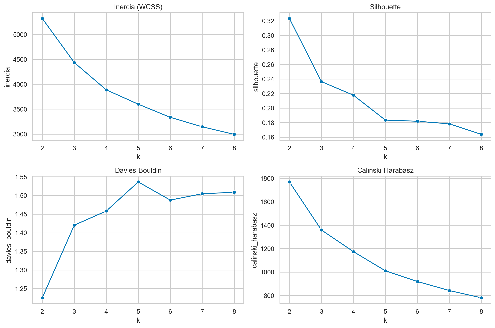
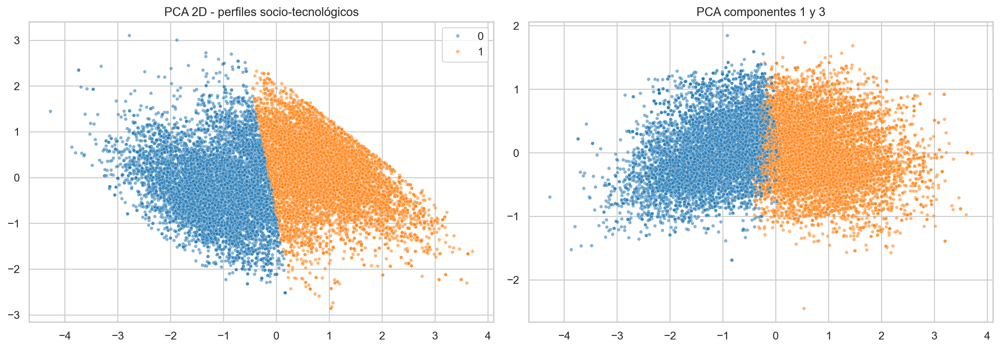
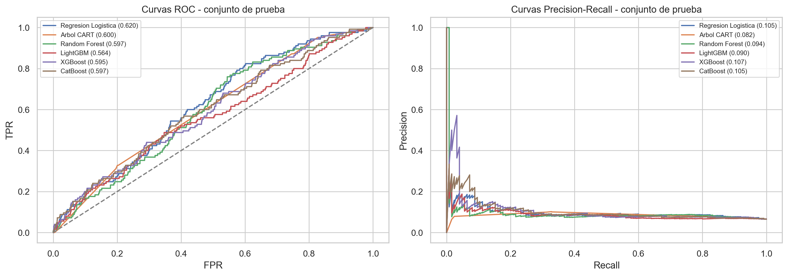
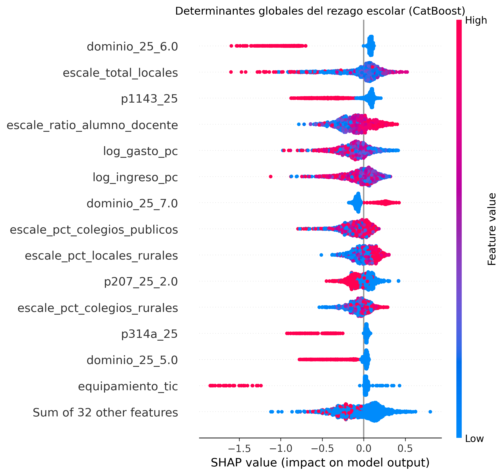

# Brecha digital y rezago escolar en el Perú: integración ENAHO-ESCALE 2025 con aprendizaje automático explicable

**Unidad de Inteligencia Artificial - Escuela Profesional de Ingeniería de Sistemas**  
**Curso:** Inteligencia Artificial | **Corte:** ENAHO + ESCALE 2025

## Resumen

Se construyó un pipeline reproducible para caracterizar la brecha digital y predecir rezago escolar en estudiantes peruanos de 6 a 17 años. Se integraron microdatos ENAHO 2025 de vivienda, hogar, persona, educación y economía con indicadores distritales ESCALE de matrícula, docentes, gestión y ruralidad. El dataset final contiene 23,668 estudiantes, 1,240 distritos y 5,050 conglomerados; 9,382 observaciones fueron evaluables para rezago, con 520 casos positivos (5.54%). Para evitar fuga de datos se aplicaron particiones por `conglome_25`, transformaciones ajustadas dentro de cada fold y exclusión de las variables que construyen directamente el target. K-Means identificó dos perfiles socio-tecnológicos; el perfil rural vulnerable presentó 6.19% de rezago frente a 5.07% en el urbano consolidado. En clasificación, CatBoost obtuvo el mayor PR-AUC promedio en GroupKFold (0.0937) y fue seleccionado como modelo campeón. En prueba, XGBoost alcanzó el mayor PR-AUC puntual (0.1068), mientras la regresión logística logró el mayor recall (0.672). SHAP mostró que el dominio geográfico, la oferta de locales escolares, la disponibilidad de tableta, el ratio alumno/docente y los recursos económicos concentran la mayor influencia. Los resultados son predictivos y asociativos, no causales.

**Palabras clave:** ENAHO, ESCALE, rezago escolar, brecha digital, GroupKFold, CatBoost, SHAP.

## I. Introducción

La desigualdad educativa peruana combina restricciones económicas del hogar, disponibilidad de tecnologías de información y heterogeneidad territorial de la oferta escolar. La guía de evaluación exige integrar ENAHO y ESCALE 2025, descubrir perfiles no supervisados, comparar modelos supervisados y auditar sus decisiones con SHAP [1]. La ficha técnica ENAHO describe una encuesta probabilística y estratificada con unidades primarias de muestreo basadas en conglomerados [2]. Esta estructura invalida la suposición de independencia de una partición aleatoria simple: estudiantes de un mismo conglomerado comparten condiciones territoriales y familiares.

El objetivo fue desarrollar un pipeline completo y reproducible que: (i) preserve correctamente llaves y geocódigos; (ii) defina rezago según edad normativa y grado; (iii) evite contaminación espacial entre entrenamiento y prueba; (iv) compare perfiles y clasificadores; y (v) exponga los factores aprendidos por el modelo sin confundir asociación con causalidad.

## II. Ingeniería de datos y prevención de fuga

Se emplearon los módulos ENAHO M100, M200, M300 y Sumaria, junto con el Padrón de Instituciones Educativas y el Padrón de Locales ESCALE. Las llaves `conglome_25`, `vivienda_25`, `hogar_25`, `codperso_25` y `ubigeo_25` se leyeron como texto; `ubigeo_25` y `codgeo` se normalizaron a seis caracteres. Los espacios residuales se trataron como nulos y se toleraron codificaciones UTF-8/Latin-1.

La fusión siguió el nivel de cada fuente: persona (`M300 + M200`), hogar (`Sumaria + M100`) y distrito (`ENAHO + agregados ESCALE`). Se aplicaron validaciones `one_to_one` y `many_to_one`. Después del cruce se restringió la población a edades de 6 a 17 años. El rezago se definió para estudiantes matriculados o asistentes en primaria/secundaria como:

`rezago = 1[edad > edad_normativa(nivel, grado) + 1]`.

La tolerancia de un año sigue la formulación normativa adoptada en el proyecto [3]. Las variables `p208a_25`, `p308a_25`, `p308b_25`, `edad_normativa` y `poblacion_evaluable_rezago` fueron excluidas del modelado supervisado por ser componentes directos o proxies del target.

El protocolo anti-fuga tuvo tres capas: una partición externa 80/20 con `GroupShuffleSplit`, validación interna con `GroupKFold(5)` y preprocesamiento dentro de un `Pipeline`. Los 3,243 conglomerados de entrenamiento y 811 de prueba no se solapan. Se aplicó imputación por mediana, `RobustScaler` y one-hot ajustados exclusivamente con entrenamiento. Los pesos combinaron balance de clases y el factor muestral `factor07_25` normalizado.

## III. Aprendizaje no supervisado

El clustering utilizó diez variables socioeconómicas, digitales y escolares, sin incluir `rezago_escolar`. Se comparó K-Means con Gaussian Mixture y se evaluó `k=2,...,8` mediante Silhouette, Davies-Bouldin y Calinski-Harabasz. El mejor balance correspondió a `k=2`: Silhouette 0.3233, Davies-Bouldin 1.2251 y Calinski-Harabasz 1769.0. Las tres primeras componentes PCA explicaron 81.21% de la varianza.

| Perfil | n | Internet hogar | Uso internet | Ratio alumno/docente | Rezago | Exclusión digital |
|---|---:|---:|---:|---:|---:|---:|
| Rural vulnerable con aislamiento digital y dependencia pública | 10,239 | 91.49% | 58.70% | 12.38 | 6.19% | 3.14% |
| Urbano consolidado con alta conectividad y mejores recursos | 13,429 | 98.01% | 83.16% | 17.43 | 5.07% | 0.08% |

El perfil rural exhibe menor ingreso/gasto, menor conectividad y mayor exclusión digital. La tasa de rezago es 1.12 puntos porcentuales superior. El contraste del target se realizó después de ajustar clusters y solo con fines descriptivos, evitando circularidad.

## IV. Modelado supervisado

Se compararon regresión logística, CART, Random Forest, LightGBM, XGBoost y CatBoost. La selección se basó en PR-AUC media de GroupKFold debido a la prevalencia positiva de 5.54%.

| Modelo | PR-AUC CV | ROC-AUC test | PR-AUC test | F1 macro | Recall | Brier |
|---|---:|---:|---:|---:|---:|---:|
| CatBoost | **0.0937** | 0.5969 | 0.1048 | 0.4855 | 0.384 | 0.1803 |
| Random Forest | 0.0912 | 0.5973 | 0.0939 | 0.5170 | 0.056 | **0.0941** |
| XGBoost | 0.0887 | 0.5951 | **0.1068** | 0.4904 | 0.320 | 0.1677 |
| Regresión logística | 0.0846 | **0.6196** | 0.1055 | 0.4046 | **0.672** | 0.2595 |
| LightGBM | 0.0844 | 0.5637 | 0.0902 | **0.5247** | 0.216 | 0.1280 |
| CART | 0.0656 | 0.6001 | 0.0820 | 0.5092 | 0.328 | 0.2377 |

CatBoost fue el campeón por el criterio predefinido. En prueba produjo 1,316 verdaderos negativos, 483 falsos positivos, 77 falsos negativos y 48 verdaderos positivos. La sensibilidad moderada y la cantidad de falsos positivos reflejan el costo del balanceo de una clase poco frecuente. Las probabilidades no deben utilizarse operativamente sin calibración adicional.

## V. Explicabilidad algorítmica

Se aplicó `shap.TreeExplainer` a CatBoost sobre los 1,924 casos del test. Los valores SHAP se expresan en log-odds. Las variables globalmente más influyentes fueron `dominio_25_6.0`, `escale_total_locales`, `p1143_25`, `escale_ratio_alumno_docente`, `log_gasto_pc` y `log_ingreso_pc`.

La dependencia gasto-riesgo fue no lineal y varió con el ratio alumno/docente. La interacción lengua originaria-internet mostró una señal más débil; por ello no se afirma un efecto multiplicador fuerte. El caso positivo extremo alcanzó probabilidad 0.828 y estuvo impulsado por alto ratio alumno/docente, dominio territorial, lengua originaria y ruralidad. El caso negativo extremo obtuvo 0.006; equipamiento TIC, computadora, tableta e indicadores económicos redujeron el riesgo.

## VI. Recomendaciones, limitaciones y conclusiones

Los resultados respaldan priorizar intervenciones territoriales que combinen conectividad efectiva, equipamiento utilizable y capacidad escolar. Se recomienda: (1) focalizar acompañamiento en conglomerados del perfil rural vulnerable; (2) complementar entrega de dispositivos con uso efectivo y soporte; (3) monitorear distritos con ratios alumno/docente elevados; y (4) emplear el modelo como instrumento de priorización asistida, nunca como decisión automática sobre estudiantes.

Las principales limitaciones son el diseño transversal 2025, la baja prevalencia, la capacidad predictiva moderada y la agregación de ESCALE a nivel distrital. SHAP explica el comportamiento del modelo, no efectos causales ni mecanismos de política. Antes de un despliegue se requieren calibración, validación temporal/geográfica y auditorías de equidad por sexo, lengua y territorio.

El trabajo entrega un pipeline reproducible, con llaves preservadas, cero solapamiento de conglomerados, comparación de seis clasificadores y explicaciones globales e individuales. Su valor principal es metodológico: combina fuentes oficiales y controles estrictos para producir evidencia auditable.

## Referencias

[1] Lab de Inteligencia Artificial, *Guía de Evaluación - Proyecto IA: Brecha Digital y Educación 2025*, 2025.  
[2] INEI, *Ficha Técnica de la Base de Datos Panel ENAHO 2021-2025*, Lima, 2025.  
[3] Ministerio de Educación del Perú, *Resolución Ministerial N.° 064-2022-MINEDU*, Lima, 2022.  
[4] INEI, *Cuestionario ENAHO 2025: Módulos 100 y 300*, Lima, 2025.  
[5] MINEDU-ESCALE, *Diccionario del Censo Educativo 2025*, Lima, 2025.  
[6] S. M. Lundberg and S.-I. Lee, “A Unified Approach to Interpreting Model Predictions,” *NeurIPS*, 2017.  
[7] L. Prokhorenkova et al., “CatBoost: Unbiased Boosting with Categorical Features,” *NeurIPS*, 2018.
